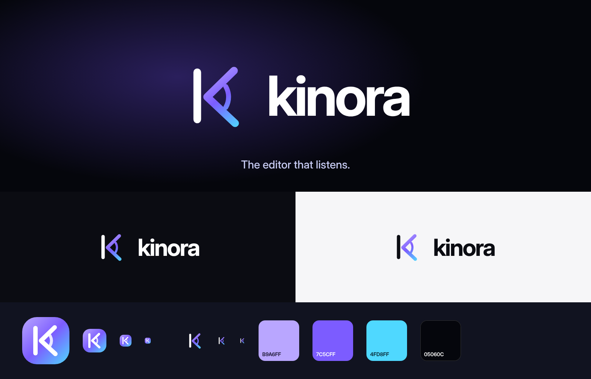

# Brand proposal: Kinora

Status: **proposed default, waiting for the owner (D-02)**. The web app, app icons, launch trailer and email product name use it on this branch, so it can be reviewed in place. Changing it is one constant (`apps/web/src/brand/brand.tsx`) plus the icons and a few strings. Internal names (`@ancs/*` packages, `ANCS_*` settings) stay as they are.

## Shortlist

| Name | Why it fits | Risks found (quick web search, not a trademark search) |
|---|---|---|
| **Kinora** *(default)* | The name of the Lumière brothers' 1896 home-movie viewer, the first "cinema at home". It suits a studio that makes polished video easy for one person. Short, two clear vowels, easy to say in English and Chinese, reads as a product rather than a feature. | No current software or AI company found under the name. Nearby names exist in other fields (KineMaster, a mobile editor; Kinara, an edge-AI chip maker), so a proper trademark and domain check is still needed. |
| **Sayframe** | Literally the core interaction: say it, frame it (talk and point). Self-explanatory on a landing page. | No conflicts found. Longer and more functional than evocative; harder to make an icon from. |
| **Earshot** | "Within earshot": the editor is always listening, which fits "The editor that listens." | A common English word already used by podcasts and media brands, so weak to trademark. |
| **Cutaway** / **Dailies** | Film-editing words that editors know. | Generic industry terms, effectively impossible to own. |

Ruled out: **Hark** (hark.com is a large, newly funded AI company), **CuttingRoom** (an existing cloud video editor), **Eddie** (Eddie AI, an existing AI video editor).

**Tagline:** kept as **"The editor that listens."** It works with Kinora: the name carries the cinema, the line carries the AI.

## Logo

- **Mark:** a "K" made from a timeline playhead (the upright stroke) and two arms that open like a voice cone, with one sound wave inside: an editor that listens. The upright uses the current text colour (white on dark, ink on light); the arms and wave use the brand gradient.
- **App icon:** the same mark in white on a gradient tile. It's used for the sidebar, favicon, home-screen icons and the trailer.
- **Wordmark:** "kinora", lowercase, Inter Display Bold, tracking −4.5 %. In running text and the UI the name is "Kinora".
- **Minimum size:** the mark stays legible at 16 px; below 24 px prefer the app icon.
- **Clear space:** at least half the mark's width around the lockup.

| Colour | Hex | Use |
|---|---|---|
| Lilac | `#B9A6FF` | Gradient start |
| Violet | `#7C5CFF` | Gradient middle, primary accent |
| Cyan | `#4FD8FF` | Gradient end |
| Ink | `#05060C` | Dark backgrounds |

The UI itself keeps the neutral design-system tokens (ADR 0019). Brand colours appear only inside the logo and icons.

## Files

| File | What |
|---|---|
| `kinora-mark-on-dark.svg`, `kinora-mark-on-light.svg` | Full-colour mark |
| `kinora-app-icon.svg` | App icon (same as `apps/web/public/icons/icon.svg`) |
| `kinora-brand-sheet.png` | Lockups, sizes and colours |
| `apps/web/public/icons/*.png` | 192 / 512 / maskable 512 / Apple touch 180 |

## What the owner still decides

1. Accept Kinora or pick another name. If another, change `BRAND_NAME` and the strings listed in `brand.tsx`, then re-render the trailer (`docs/marketing/launch-trailer/README.md`).
2. Run a trademark search in your markets and check domains (for example `kinora.app`, `kinora.video`, `getkinora.com`). Then set the production domain (D-02 → I-02, B-03).
3. Set `ANCS_PRODUCT_NAME` and `ANCS_EMAIL_FROM` in production. Emails default to "Kinora" when `ANCS_PRODUCT_NAME` is not set.
